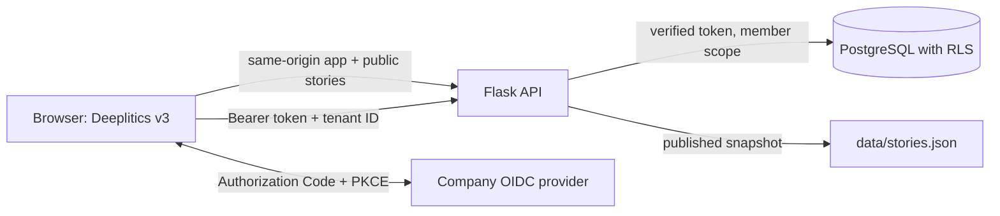

# Deeplitics v3

Deeplitics v3 is a separate, API-backed reading app. It leaves the current
static `frontend/` prototype and the earlier `v2/` experiment in place.

## What works

- Public story feed from `data/stories.json`, served by `GET /api/v1/stories`.
- Search, topic filters, story details, source links and saved-story view.
- OIDC Authorization Code login with PKCE (S256) for a company workspace.
- Encrypted per-member preferences: saved story IDs and topic filters.
- A member can read, update or erase their own preferences through the API and settings dialog.
- Postgres row-level security checks both the tenant and the authenticated membership.



The story snapshot is public editorial content. Workspace settings are personal
data and are encrypted before they reach Postgres. The app does not collect a
profile name or email. The access token stays in browser memory; the short-lived
PKCE verifier/state and workspace ID use `sessionStorage`. Reloading the page
requires signing in again. The application does not store a refresh token.

## Local setup

1. Start Postgres: `docker compose -f docker-compose.backend.yml up -d`.
2. Copy `.env.backend.example` to `.env.backend`; generate fresh local encryption
   keys and set the API database URL to the local Postgres service.
3. Register a public OIDC client. Enable Authorization Code + PKCE (S256), add
   the exact redirect URI `http://127.0.0.1:5000/app/`, and permit the local app
   origin at the provider's token endpoint. Use the API audience expected by
   `OIDC_AUDIENCE`. Do not create a browser client secret.
4. Export the environment file into the shell, install
   `backend/requirements.txt`, and run:

   ```sh
   flask --app backend.app db upgrade
   flask --app backend.app run --host 127.0.0.1
   ```

5. Open `http://127.0.0.1:5000/app/`. Set `DEFAULT_TENANT_ID`, or open
   `/app/?tenant=<workspace-uuid>`. The OIDC subject must be provisioned as an
   active tenant member before the app can load private workspace preferences.
The Workspace dialog includes a delete action for saved preferences; deactivating
a membership through the operator command also removes that member's preferences.

For the container version, register `http://127.0.0.1:8000/app/` as the
redirect URI and run:

```sh
docker compose -f docker-compose.backend.yml --profile app up --build -d
docker compose -f docker-compose.backend.yml --profile app run --rm backend flask --app backend.app db upgrade
```

Then open `http://127.0.0.1:8000/app/`. The profile keeps the API port bound
to loopback and is intended for local or staging use.

`GET /api/v1/public-config` exposes only public browser-client settings. A
client secret is never used by the web app. The provider must issue an RS256
access token whose issuer, audience, expiry and subject match the backend's
OIDC configuration.

## Deployment shape for the available hardware

- Use one MacBook for development and the second for review/operations. Keep
  source control and local secrets separate; do not use either laptop as an
  always-on production server.
- Use a Raspberry Pi for synthetic-data staging only, behind a TLS reverse
  proxy and on a private network. Keep its application port bound to loopback.
- Use the second Pi as an encrypted backup/monitoring target, with a separate
  restricted account and an off-site copy. A backup is not a live replica.
- Put real company data on an EU-hosted managed PostgreSQL service with verified
  TLS, encrypted backups, tested restore and separate migration/runtime roles.
  The Pi setup does not provide high availability or production-grade recovery.

Before real data: finish a privacy and security review, assign retention and
deletion periods, document processors and transfers, configure an incident
process, and test backup restore and membership revocation. This code does not
certify DSGVO compliance.
